# 谜盒 PuzzleBox

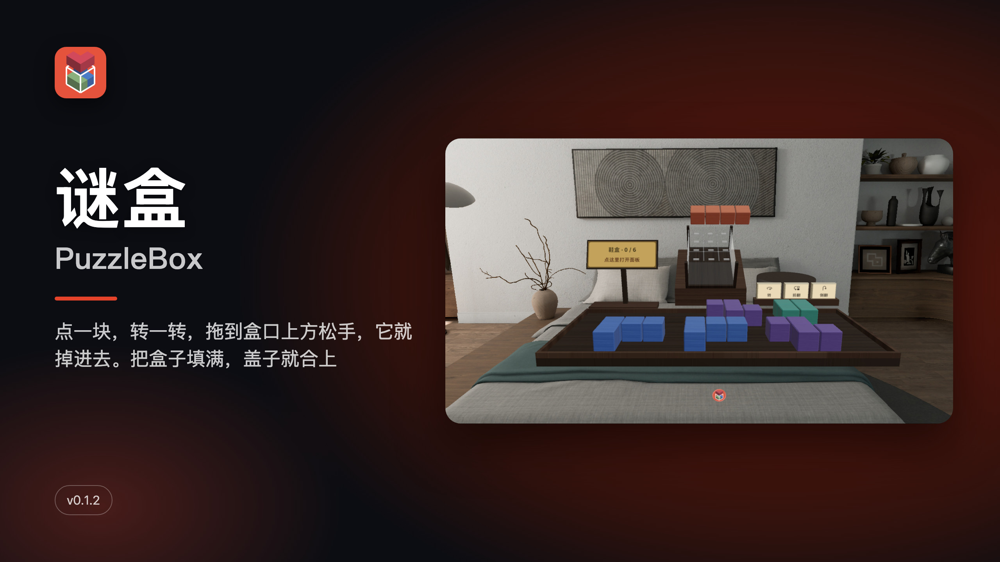

**中文** · [English](#english)

点一块，转一转，拖到盒口上方松手，它就掉进去。把盒子填满，盖子就合上。

PICO OS 6 空间应用（Shared Space，Spatial SDK 6.1.9）。桌上一只倾斜 30° 的透明谜盒，前面一托盘彩色积木；右边一块控制窗。全部本机运行，不联网、不需要账号。

## 怎么玩

- 点托盘里一块积木，它飞到盒子右边的转向台上
- 点转向台前的三个木签 [转] [前翻] [侧翻]，块真的在你面前翻 90°
- 捏住它拖到盒口上方，盒里实时画出落点；松手，它沿盒子掉进去，停在第一次碰到东西的高度（手柄也可以直接点盒口一格）
- 压住了下面的空格，那一格在亚克力里亮暗红；冒出盒口的不让落
- 正好填满，盖子从上方落下扣上，盒子抬起来转一圈

## 15 只盒子

- 热身：糖盒、骰子盒、铅笔盒、茶叶罐、首饰盒
- 进阶：饭盒、眼镜盒、月饼盒、鞋盒、工具箱
- 索玛：点心盒、收纳箱、储钱罐、棋盒，最后是 1933 年 Piet Hein 的索玛立方（7 块，240 种解；装好后 [再装一次] 记你找到了几种）
- 每只记最好用时和最少步数；提示开关、[帮我放一块]、[悔一步]、「拼不完了」检测都由内置求解器按当前摆法现算

## 截图

| | |
|---|---|
|  长条在盒口上方，就要掉进去 |  选中的块在转向台上，前面三个木签 |
| 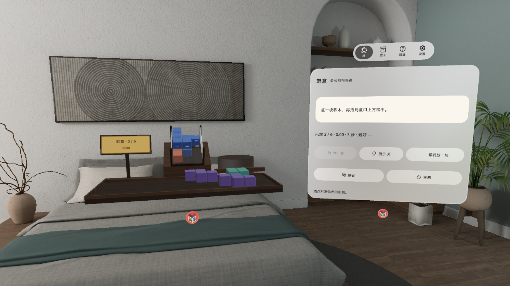 装到一半：控制窗写着下一步 | 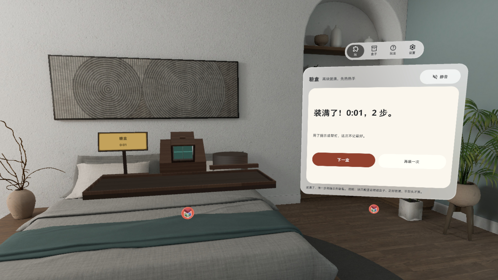 装满了：盖子扣上，结果卡记用时和步数 |
| 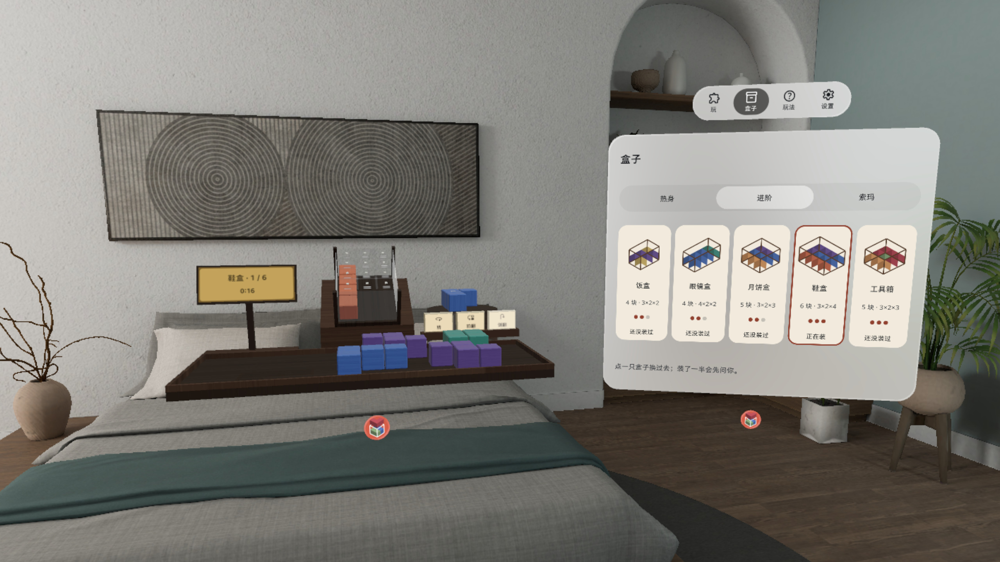 盒子页：热身 / 进阶 / 索玛 15 只 | 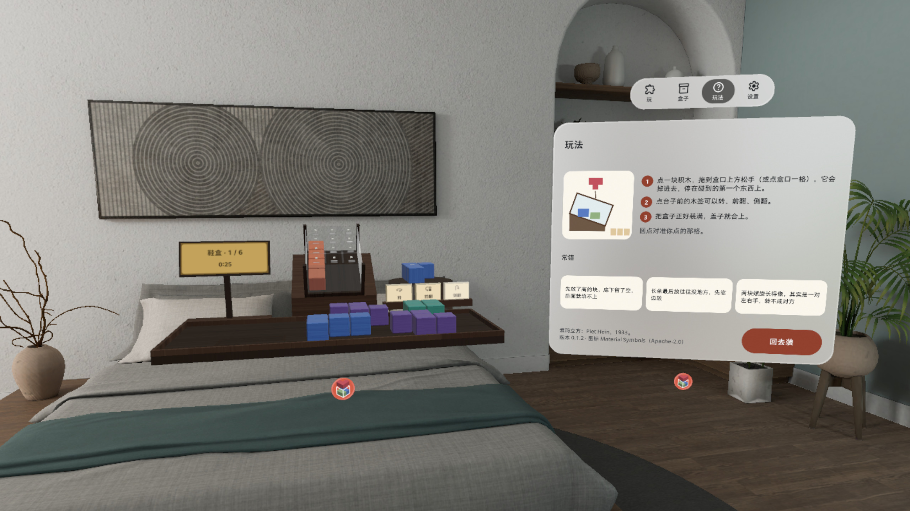 玩法页：一张图三句话 |

截图和演示视频在 PICO 模拟器上录制，3D 操作由调试广播驱动，**非真实手势录像**。

## 安装

```bash
adb install -r PuzzleBox-v0.1.2.apk
pico-cli app launch com.kejing.puzzlebox
```

Release 里的 APK 是 `./gradlew assembleRelease` 出的未签名包，用于提交 Vibe Lab；自己装机请先用自己的 key 签名，或在本仓库 `./gradlew assembleDebug` 出调试包安装。

## 构建

```bash
export JAVA_HOME=<JDK 17+>
./gradlew assembleDebug :app:testDebugUnitTest   # 43 个 JVM 单测：规则、15 只盒子的解、求解器、流程、布局
```

工程结构、调试命令见 [AGENTS.md](AGENTS.md)。

## 致谢 / 许可

- 索玛立方：Piet Hein，1933；规则独立实现
- 字体 Noto Sans（SIL OFL 1.1）；图标 Material Symbols（Apache 2.0）
- 音效：Kenney Impact Sounds（CC0）、freesound 254343（CC0）；装满提示音为合成

---

## English

Pick a block, turn it, drag it over the box and let go. Fill it up and the lid snaps shut.

A PICO OS 6 spatial app (Shared Space, Spatial SDK 6.1.9). A clear puzzle box tilted 30° sits on your desk with a tray of coloured blocks in front of it and a control window to the right. Runs fully on device: no network, no account.

### How to play

- Tap a block in the tray; it flies to the turn stand beside the box
- Tap the three tabs on the stand, [Turn] [Flip fwd] [Flip side], and the block really rolls 90° in front of you
- Pinch it and drag it over the mouth of the box; a ghost shows where it will land. Let go and it drops straight down until it hits something (with a controller you can also tap a cell on the mouth)
- A cell you cover up glows dark red through the acrylic; a block that would stick out is not allowed to drop
- Fill the box exactly and the lid drops and clicks shut; the box lifts and turns once for you

### 15 boxes

- Warm-up: Candy Tin, Dice Box, Pencil Case, Tea Caddy, Jewelry Box
- Getting tricky: Lunch Box, Glasses Case, Mooncake Box, Shoebox, Toolbox
- Soma: Snack Box, Storage Crate, Piggy Bank, Chess Box, and finally Piet Hein's 1933 Soma Cube (7 pieces, 240 solutions; [Play again] counts how many you have found)
- Best time and fewest moves per box; hints, [Place one for me], [Undo] and "this can't be finished" detection come from a built-in solver working on your current position

### Screenshots

| | |
|---|---|
| 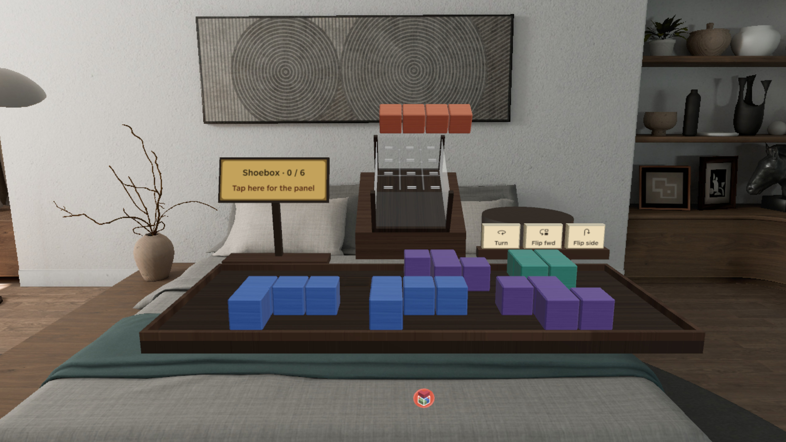 The long bar above the mouth, about to drop | 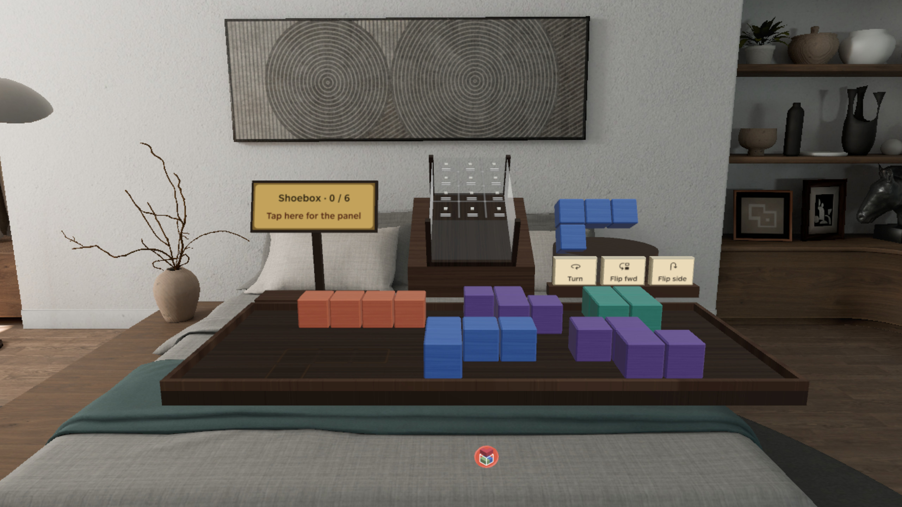 The selected block on the turn stand, three tabs in front |
| 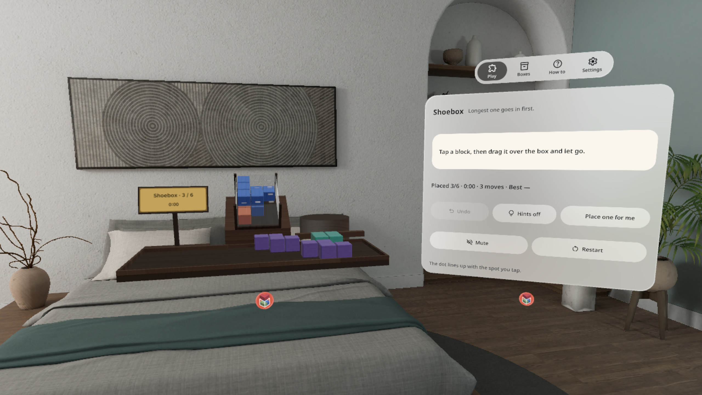 Half full: the control window says what to do next | 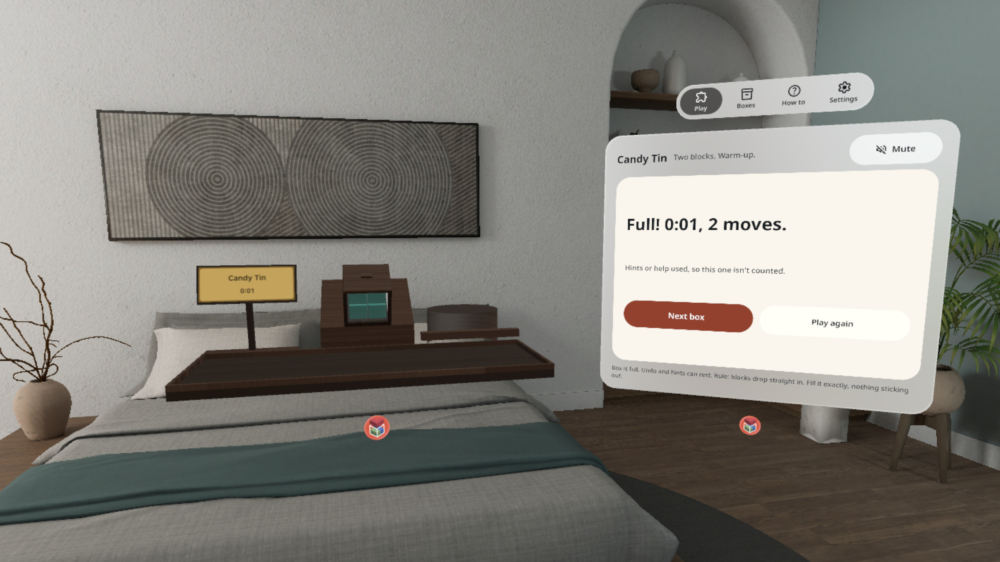 Full: the lid is shut, the result card shows time and moves |
| 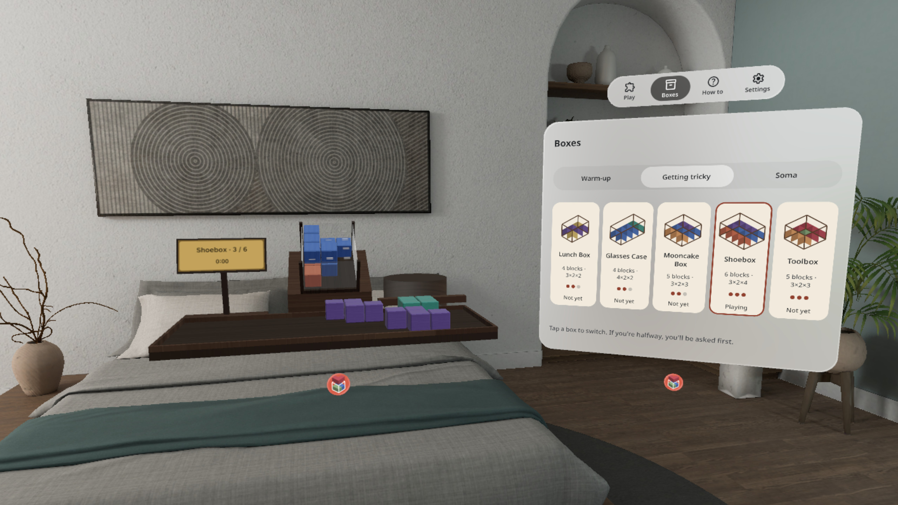 Boxes page: 15 boxes in Warm-up / Getting tricky / Soma | 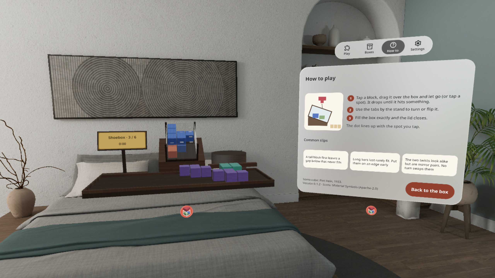 How to play: one picture, three lines |

Screenshots and the demo video were recorded on the PICO emulator with 3D actions driven by debug broadcasts. **Not a real hand-gesture recording.**

### Install

```bash
adb install -r PuzzleBox-v0.1.2.apk
pico-cli app launch com.kejing.puzzlebox
```

The APK on the Release is the unsigned `assembleRelease` build used for the Vibe Lab submission; sign it with your own key before installing, or build a debug APK from this repo with `./gradlew assembleDebug`.

### Credits / licences

- Soma cube: Piet Hein, 1933; rules implemented independently
- Font Noto Sans (SIL OFL 1.1); icons Material Symbols (Apache 2.0)
- Sounds: Kenney Impact Sounds (CC0), freesound 254343 (CC0); the "box full" chime is synthesised
